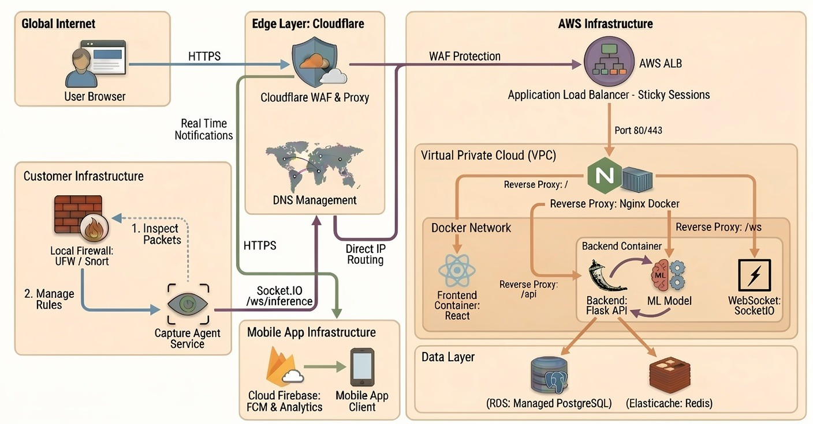
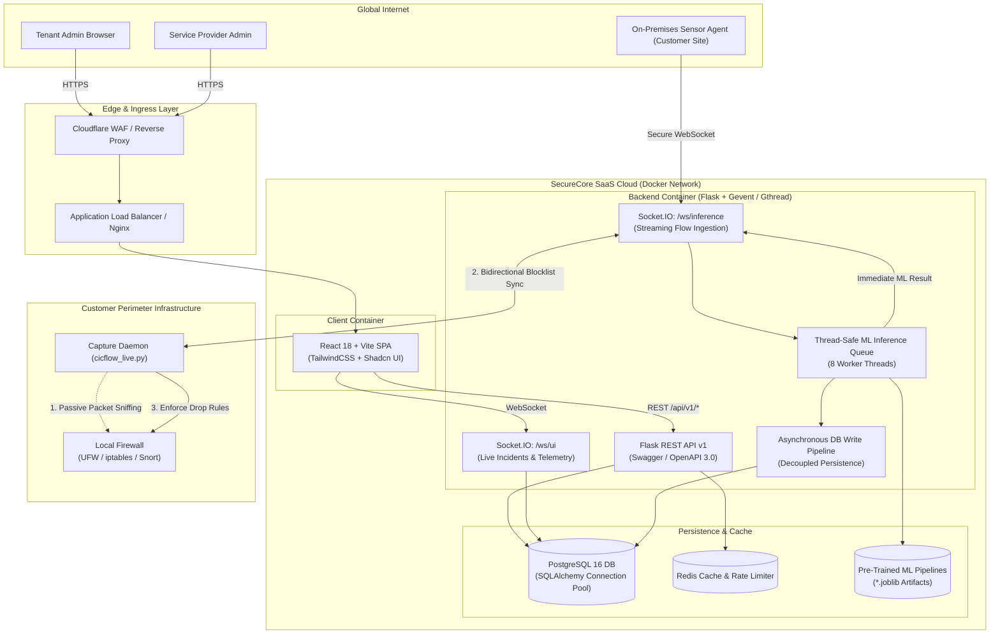
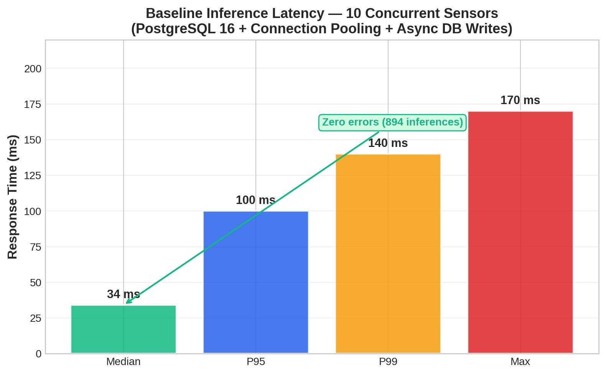
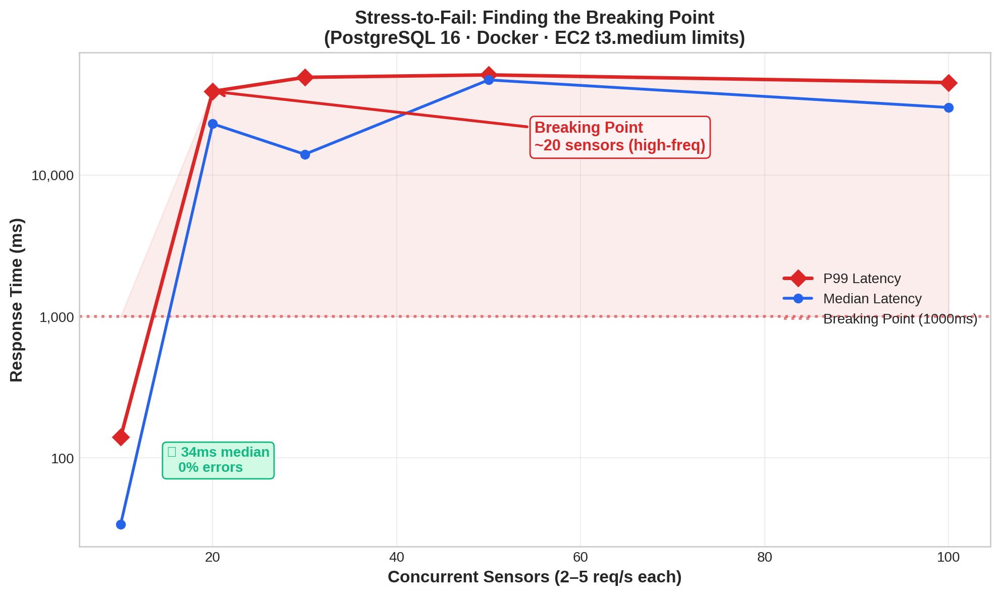
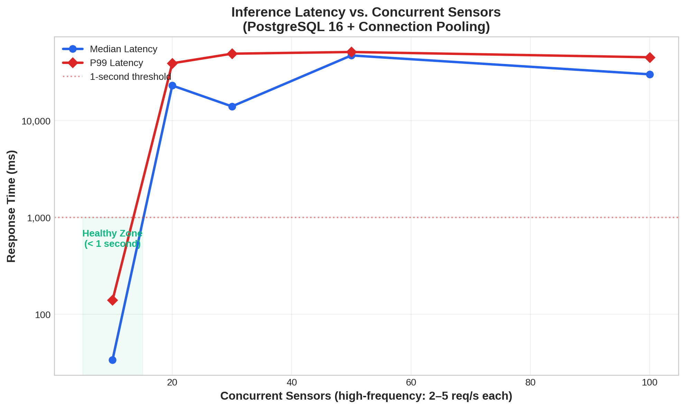
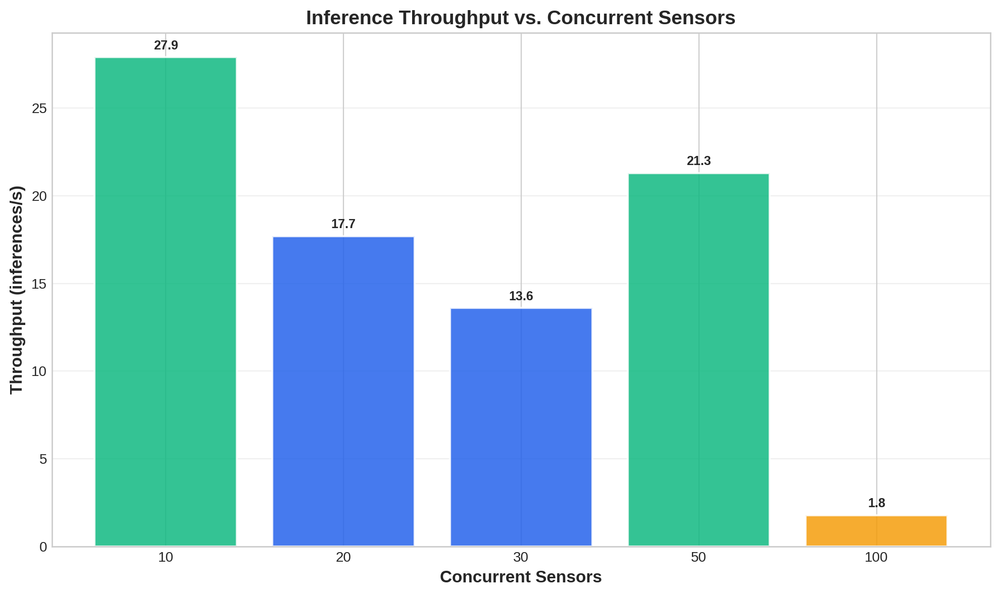

# SecureCore IDS — AI-Powered Enterprise Intrusion Detection & Prevention SaaS Platform

[](https://www.python.org/)
[](https://flask.palletsprojects.com/)
[](https://react.dev/)
[](https://www.postgresql.org/)
[](https://www.docker.com/)
[](https://scikit-learn.org/)
[](#license--disclaimer)

**SecureCore IDS** is a production-ready, full-stack **Network Intrusion Detection and Prevention System (NIDS/NIPS)** architected as a **multi-tenant Software-as-a-Service (SaaS)** platform. The system bridges edge network traffic telemetry with cloud-hosted machine learning inference pipelines, delivering **sub-50ms threat classification**, real-time WebSocket incident dispatch, bi-directional automated firewall synchronization, and comprehensive compliance reporting.

---

## Table of Contents

- [1. Executive Summary](#1-executive-summary)
- [2. System Architecture & Data Flow](#2-system-architecture--data-flow)
- [3. Machine Learning & Threat Detection](#3-machine-learning--threat-detection)
- [4. Performance & Stress Test Benchmarks](#4-performance--stress-test-benchmarks)
- [5. Visual Platform Walkthrough](#5-visual-platform-walkthrough)
  - [5.1 Public Portal & SaaS Onboarding](#51-public-portal--saas-onboarding)
  - [5.2 Company / Customer Security Center](#52-company--customer-security-center)
  - [5.3 Service Provider / Superadmin Dashboard](#53-service-provider--superadmin-dashboard)
- [6. Security Architecture & Hardening](#6-security-architecture--hardening)
- [7. On-Premises Capture Agent (ELF) & Firewall Sync](#7-on-premises-capture-agent-elf--firewall-sync)
- [8. Technology Stack](#8-technology-stack)
- [9. Repository Structure](#9-repository-structure)
- [10. Quick Start & Deployment](#10-quick-start--deployment)
- [11. Testing & Quality Assurance](#11-testing--quality-assurance)
- [12. License & Disclaimer](#12-license--disclaimer)

---

## 1. Executive Summary

Modern enterprise networks face escalating threat vectors — ranging from high-rate volumetric DDoS floods and stealthy port scans to targeted web exploitation (SQL Injection, Cross-Site Scripting) and botnet intrusions. Traditional signature-based detection systems struggle against zero-day variations and polymorphic network behavior.

**SecureCore IDS** delivers an AI-driven, hybrid cloud-edge defense paradigm:

- **On-Premises Edge Capture**: Lightweight, non-intrusive sensor daemon (`elf/cicflow_live.py`) sniffs raw packets, aggregates bidirectional flows, calculates 72 statistical network features, and streams vectors over authenticated WebSockets.
- **High-Throughput ML Cloud Engine**: Cloud backend evaluates network flow vectors through pre-trained Scikit-Learn classification pipelines (SVM, KNN, Random Forest, Decision Tree) with an average inference latency of **34ms**.
- **Real-Time Automated Remediation**: Offending IPs are flagged with severity levels; when critical thresholds are breached, the system automatically pushes blocklist updates back to the customer site to trigger firewall rule execution (UFW / iptables / Snort) at the perimeter.
- **Enterprise Multi-Tenancy**: Isolated company-centric workspaces (`company_id` scoped data models), Policy-Based Access Control (PBAC), API key management with token bucket rate limiting, push notifications via Firebase Cloud Messaging (FCM), and automated PDF compliance reports.

---

## 2. System Architecture & Data Flow

### Cloud & On-Premises Infrastructure

The platform is designed to operate seamlessly across public cloud infrastructure (simulated on AWS EC2 `t3.medium` via Docker Compose) and distributed customer perimeters.





### End-to-End Incident Lifecycle

1. **Traffic Capture**: The customer-side agent monitors physical or virtual network interfaces in promiscuous mode.
2. **Feature Extraction**: Packets are aggregated into 5-tuple bidirectional network flows (Source IP, Source Port, Destination IP, Destination Port, Protocol) and transformed into a 72-dimensional statistical feature vector.
3. **Encrypted Transport**: The flow vector is transmitted over WebSocket to the cloud backend at `/ws/inference` carrying an authenticated tenant Bearer API token.
4. **Instant Classification**: The 8-worker ML pool executes the Scikit-Learn pipeline in under 50ms, returning the classification verdict (`BENIGN` or attack classification such as `DDoS`, `PortScan`, `Botnet`, etc.).
5. **Decoupled Persistence**: The result is immediately returned to the agent and published to `/ws/ui` for real-time operator alerts, while a background thread asynchronously commits the incident to PostgreSQL via connection pooling.
6. **Dynamic Perimeter Defense**: If configured for auto-blocking, the backend issues an enforcement command to the agent, which executes `ufw deny from <ATTACKER_IP>` on the client firewall.

---

## 3. Machine Learning & Threat Detection

The detection engine utilizes models trained on the benchmark **CIC-IDS2017** dataset from the Canadian Institute for Cybersecurity, covering benign traffic and contemporary network attacks.

### Monitored Threat Classifications

- **Denial of Service (DoS / DDoS)**: LOIC, HOIC, Hulk, Slowloris, Slowhttptest, GoldenEye.
- **Reconnaissance & Probing**: PortScan, OS Fingerprinting, Vulnerability Scanning.
- **Web Application Exploitation**: SQL Injection (SQLi), Cross-Site Scripting (XSS), HTTP Brute Force.
- **Malware & Lateral Movement**: Botnet traffic (Ares), SSH/FTP Patator, Infiltration.
- **Protocol Anomalies**: Heartbleed attack exploits.

### Pre-Trained Model Artifacts (`models/`)

The repository includes pre-trained, production-ready `.joblib` pipelines:

| Model Pipeline | File Name | Characteristics | Best Suited For |
|:--|:--|:--|:--|
| **SVM (Polynomial)** | `svm_poly_pipeline.joblib` | High non-linear separation margin | Complex web attack & anomaly detection |
| **SVM (RBF Kernel)** | `svm_rbf_pipeline.joblib` | Smooth radial basis function | Multi-class intrusion boundary mapping |
| **K-Nearest Neighbors (k=16)** | `knn_16_pipeline.joblib` | Distance-weighted clustering | Fast volumetric DDoS & flood clustering |
| **K-Nearest Neighbors (k=8)** | `knn_8_pipeline.joblib` | Finer neighborhood resolution | Reconnaissance & scan pattern detection |
| **Random Forest (Depth 8)** | `rf_depth8_pipeline.joblib` | Ensembled decision trees | Robust feature ranking & high precision |
| **Decision Tree (Depth 8)** | `dt_depth8_pipeline.joblib` | Fast tree traversal | Extremely low-latency microsecond checks |

### 72-Feature LycoSTand Extraction Vector

Features extracted in real time include:
- **Packet Length Metrics**: Min, Mean, Max, Standard Deviation of forward and backward packet sizes.
- **Inter-Arrival Times (IAT)**: Mean, Min, Max, and Standard Deviation of flow, forward, and backward packet intervals.
- **Header & Flag Counts**: FIN, SYN, RST, PSH, ACK, URG, ECE, CWR flags, header lengths.
- **Flow Rates**: Flow Bytes/s, Flow Packets/s, Sub-flow forward/backward bytes.
- **Active / Idle Windows**: Duration of active communication burst vs. idle periods.

---

## 4. Performance & Stress Test Benchmarks

To validate production viability under sustained enterprise load, the platform underwent comprehensive load and stress-to-fail testing using **Locust 2.43** within Docker resource limits matching an **AWS EC2 t3.medium** instance (2 vCPUs, 4 GB RAM backend, 512 MB PostgreSQL).

### Performance Visualizations

| Baseline Latency (Regulated Load) | System Breaking Point Ramp-Up |
|:---:|:---:|
|  |  |
| **Latency vs. Concurrent Sensors** | **Throughput vs. Concurrent Sensors** |
|  |  |

### Benchmark Results Summary

| Concurrent Sensors | Request Frequency | Median Latency | P95 Latency | P99 Latency | Throughput | Error Rate | System Behavior |
|:--:|:--:|:--:|:--:|:--:|:--:|:--:|:--|
| **10** | 0.5–2.0s / sensor | **34 ms** | **100 ms** | **140 ms** | **27.9 req/s** | **0.0%** | Optimal operational state; sub-50ms inference |
| **20** | 0.2–0.5s / sensor | 23.0 s | 37.0 s | 39.0 s | 17.7 req/s | 0.0% | Queue starts buffering; zero packet drops |
| **30** | 0.2–0.5s / sensor | 14.0 s | 46.0 s | 49.0 s | 13.6 req/s | 0.0% | Sustained queue saturation under accelerated load |
| **50** | 0.2–0.5s / sensor | 47.0 s | 50.0 s | 51.0 s | 21.3 req/s | 68.4% | Server busy backpressure protection triggered |
| **100** | 0.2–0.5s / sensor | 30.0 s | 45.0 s | 45.0 s | 1.8 req/s | 3.9% | Graceful recovery and backoff enforcement |

### Core Performance Architectural Optimizations

1. **SQLAlchemy Connection Pooling**:
   Configured with `QueuePool(pool_size=10, max_overflow=20, pool_pre_ping=True)`. Eliminates per-request TCP handshakes, reducing database overhead from ~5ms to **~0.1ms (30–50× speedup)**.
2. **Two-Phase Decoupled Write Pipeline**:
   - *Phase 1 (Sync)*: ML classification executes and emits the socket verdict back to the client immediately (~34ms).
   - *Phase 2 (Async)*: Database logging, audit trails, and token quota increments are committed in a background worker thread.
3. **Real-World Capacity**:
   Under standard network monitoring rates (1 request every 1–2 seconds per sensor), a single `t3.medium` instance comfortably services **over 80 concurrent edge sensors** with zero packet loss.

---

## 5. Visual Platform Walkthrough

### 5.1 Public Portal & SaaS Onboarding

The public-facing frontend provides an enterprise SaaS experience with self-service onboarding and subscription tiers.

#### Landing Page & Value Proposition
Clean, dark-mode cybersecurity interface introducing the core AI-driven platform.


#### Platform Features & Capabilities
Feature overview highlighting real-time detection, automated response, advanced analytics, and cross-platform agent support.


#### SaaS Pricing & Subscription Plans
Tiered plans (Free Trial, Small Companies, Enterprise) with transparent limits on alerts, agents, and custom rule configurations.


#### Sales & Customer Inquiry Portal
Direct communication channel for enterprise inquiries and technical consultations.


#### Tenant Onboarding — Step 1: Account Creation
Company-centric registration capturing administrative contact, company name, and secure credentials.


#### Tenant Onboarding — Step 2: Payment & Subscription Setup
Integrated billing information capture with trial verification.


#### Enterprise Authentication Portal
Secure login gate implementing HttpOnly cookies, JWT sessions, and CSRF token protection.


---

### 5.2 Company / Customer Security Center

Each registered tenant gains access to an isolated administrative workspace for monitoring threats and controlling perimeter security.

#### Tenant Security Dashboard Overview
Comprehensive security posture overview displaying daily alerts, blocked threats, active whitelist rules, network health, 7-day incident trends, severity breakdown, and live alert feeds.


#### Live Security Alerts & Incident Feed
Real-time incident stream detailing source IP, port, destination, protocol, severity rating, and one-click firewall action triggers.


#### Automated Security Intelligence & PDF Reports
Historical threat trend tracking, detection efficacy ratios, and one-click PDF compliance report exports.


#### Dynamic Firewall Blocklist Enforcement
Active list of blocked malicious IP addresses with reason tracking, timestamp metadata, and edge agent synchronization.


#### Trusted IP Whitelist Configuration
Allowlist manager preventing false positives for office gateways, VPN subnets, and monitoring servers.


#### API Token Generation & Quota Monitoring
Management of secret Bearer tokens for edge sensors (`sk_live_...`), rate limits (e.g., 10K req/min), and usage telemetry.


#### Cross-Platform Agent Downloads & Quick Setup
Pre-packaged client installers for Linux, Windows, and macOS with ready-to-use `config.yaml` generation.


#### Tenant Notification Center
Centralized notification inbox displaying system alerts, high-severity threat detections, and service announcements.


#### Profile & Credentials Management
Account profile editor allowing administrators to update credentials, email addresses, and security passwords.


#### Multi-Channel Alert Configuration
Granular dispatch toggles enabling security alerts via Email, SMS, and custom incident Webhooks.


#### Automated Digest & Security Reminders
Scheduler for automated Daily Digest emails and Weekly Security Reports with customizable delivery times.


#### Automated Data Backup & Disaster Recovery
Automated backup scheduling (daily, weekly, monthly) covering configuration, alert history, and firewall rules.


#### Subscription & Billing Management
Active plan overview, renewal dates, and payment method administration.


---

### 5.3 Service Provider / Superadmin Dashboard

A dedicated, privileged interface for platform operators to monitor infrastructure, manage tenant organizations, and inspect system telemetry.

#### Superadmin Global Command Center
High-level operational overview tracking total registered users, active subscriptions, platform-wide alerts, system health status, user growth trends, and monthly revenue.


#### Multi-Tenant User & Company Management
Comprehensive tenant administration table displaying plan tiers, alert counts, account status, and management actions.


#### Infrastructure Telemetry & System Health
Real-time hardware and service health monitoring (CPU load, memory allocation, disk capacity, database connectivity, ML inference engine, and WebSocket socket states).


#### Global Push Notification Dispatcher
Multi-target announcement composer supporting broadcasts to all tenants, individual user accounts, or custom-selected groups via Firebase Cloud Messaging.


#### Admin System Health Alert Feed
Internal diagnostic alert center logging hardware bottlenecks, database degradation warnings, and service status changes.


#### Historical Notification Audit Log
Complete audit history of administrative messages, recipients, delivery timestamps, and recipient counts.


#### Real-Time HTTP Request & Audit Stream
Nginx-style live request log stream capturing HTTP method, path, response status codes, client IP, processing time, and payload size.


---

## 6. Security Architecture & Hardening

SecureCore IDS is built strictly on **Secure-by-Design** principles:

```
┌────────────────────────────────────────────────────────────────────────┐
│                          SECURITY CONTROLS                             │
├───────────────────────┬───────────────────────┬────────────────────────┤
│ Authentication        │ Network Protection    │ Application Defense    │
├───────────────────────┼───────────────────────┼────────────────────────┤
│ • JWT in HttpOnly     │ • Strict CSP          │ • Double-Submit CSRF   │
│   SameSite Cookies    │   (no unsafe-inline)  │ • Strict Input Schemas │
│ • HMAC Bearer Tokens  │ • Dynamic Rate Limits │ • AES-256-GCM Token    │
│   for Agent Sensors   │   via Flask-Limiter   │   At-Rest Encryption   │
│ • PBAC Access Control │ • TLS Termination     │ • OWASP Top 10 Audited │
└───────────────────────┴───────────────────────┴────────────────────────┘
```

- **Company Data Isolation**: Every database query is strictly scoped by `company_id`. Cross-tenant data leakage is architecturally prohibited at the ORM layer.
- **Interactive OpenAPI 3.0 Documentation**: Complete interactive Swagger UI hosted at `/api/docs` using self-contained local assets (no external CDN dependencies).
- **Socket.IO Security**: Namespaces (`/ws/ui`, `/ws/inference`) enforce token-based handshake authentication, connection quotas per user, and packet flood throttling.

---

## 7. On-Premises Capture Agent (ELF) & Firewall Sync

The `elf/` directory houses the client-side network monitoring service:

- **`cicflow_live.py`**: Real-time packet sniffer built with Scapy/libpcap that calculates bidirectional network flow statistics matching the CIC-IDS2017 schema.
- **`config.yaml`**: Agent configuration holding the backend WebSocket URL and company API token:
  ```yaml
  api_token: "sk_live_your_token_here"
  endpoint: "https://ids.securecore.io/ws/inference"
  interface: "eth0"
  auto_block: true
  ```
- **Firewall Integration**:
  When an intrusion is classified, the backend broadcasts an auto-block event. The agent automatically executes:
  ```bash
  # Linux UFW Execution
  sudo ufw insert 1 deny from <MALICIOUS_IP> to any comment "SecureCore IDS Auto-Block"
  
  # iptables Drop Rule
  sudo iptables -I INPUT -s <MALICIOUS_IP> -j DROP
  ```

---

## 8. Technology Stack

| Domain | Technology / Library | Purpose |
|:--|:--|:--|
| **Frontend Framework** | React 18 + TypeScript | Single Page Application (SPA) architecture |
| **Build Tool** | Vite | Ultra-fast development and optimized production bundling |
| **Styling & UI Components** | TailwindCSS + Shadcn UI | Modern, dark-mode first design system |
| **Frontend State & Realtime** | Axios + Socket.IO Client | REST API consumption and real-time event streaming |
| **Backend Framework** | Python 3.11 / 3.12 + Flask | RESTful microservice API and WebSocket gateway |
| **WSGI / Async Server** | Gunicorn (`gthread` / `gevent`) | High-concurrency production application server |
| **Database & ORM** | PostgreSQL 16 + SQLAlchemy | Relational data persistence with connection pooling |
| **In-Memory Cache & Limiter** | Redis + Flask-Limiter | Session caching and API token rate limiting |
| **Machine Learning** | Scikit-Learn + Joblib + NumPy | Real-time classification and feature transformation |
| **Network Telemetry** | Scapy + Libpcap | Edge network packet capture and flow aggregation |
| **Cloud & Containerization** | Docker + Docker Compose + Nginx | Containerized deployment and reverse-proxy routing |
| **Push Notifications** | Firebase Cloud Messaging (FCM) | Cross-platform mobile and web push dispatch |
| **Benchmarking & Testing** | Locust + Pytest + Vitest | Stress testing and unit/integration verification |

---

## 9. Repository Structure

```text
.
├── client/                     # Frontend Application (React + Vite + TypeScript)
│   ├── src/
│   │   ├── components/         # Reusable UI & Layout Components (Sidebar, Navbar, Theme)
│   │   ├── contexts/           # Authentication, Theme & Notification Contexts
│   │   ├── pages/
│   │   │   ├── admin/          # Service Provider (Superadmin) Management Views
│   │   │   ├── dashboard/      # Customer (Tenant) Security Center Views
│   │   │   └── *.tsx           # Public Landing, Login, Registration, Contact Pages
│   │   └── App.tsx             # Application Router and Protected Route Guards
│   ├── Dockerfile              # Multi-stage Docker build with Nginx
│   └── package.json            # Frontend dependencies and scripts
│
├── server/                     # Backend API & WebSocket Service (Flask + SQLAlchemy)
│   ├── app/
│   │   ├── blueprints/         # Modular REST Blueprints (auth, alerts, tokens, admin, etc.)
│   │   ├── middleware/         # Security Headers, Strict CSP & Double-Submit CSRF
│   │   ├── ml/                 # Machine Learning Inference Queue and Pipeline Loader
│   │   ├── models/             # SQLAlchemy ORM Models (Company, User, Alert, Token, etc.)
│   │   ├── services/           # Alert, Firebase FCM, Notification & Firewall Services
│   │   └── utils/              # Audit Logging, AES-256 Encryption & Health Checkers
│   ├── scripts/                # Database Initialization & Schema Migration Utilities
│   ├── Dockerfile              # Production Python container configuration
│   ├── requirements.txt        # Backend dependencies
│   └── wsgi.py                 # Application WSGI entry point
│
├── models/                     # Pre-Trained Machine Learning Pipeline Artifacts (*.joblib)
├── elf/                        # On-Premises Network Packet Capture Agent & Flow Extractor
├── stress-tests/               # Locust Benchmark Suite, Stepped Tests & Performance Reports
├── docs/                       # Architecture, Database ERD & Sequence Diagrams
├── pics/                       # System Architecture & Benchmark Performance Charts
├── screens/                    # Platform UI Screenshots (main, service provider, user)
├── tests/                      # Pytest and Vitest test suites
└── docker-compose.yml          # Multi-container orchestration (DB, Frontend, Backend)
```

---

## 10. Quick Start & Deployment

### Option A: Docker Compose (Recommended)

Run the complete multi-tier platform (PostgreSQL database, Flask backend, and React frontend) with a single command:

```bash
# Clone the repository
git clone https://github.com/d4lt0n-1337/SecureCore_IDS.git
cd SecureCore_IDS

# Start all services in the background
docker compose up -d --build
```

Access the services:
- **Frontend Application**: `http://localhost:3000`
- **Backend API & Swagger Docs**: `http://localhost:5000/api/docs`
- **Health Check Endpoint**: `http://localhost:5000/health`

---

### Option B: Manual Local Development

#### 1. Backend Setup

```bash
cd server

# Create and activate virtual environment
python3 -m venv venv
source venv/bin/activate

# Install dependencies
pip install -r requirements.txt

# Configure environment variables
cp .env.example .env
# Edit .env with your database credentials and secret keys

# Initialize database schema
python scripts/init_db.py

# Run the Flask development server
python wsgi.py
```

#### 2. Frontend Setup

```bash
cd client

# Install Node dependencies
npm install

# Configure environment
cp .env.example .env.local

# Start Vite development server
npm run dev
```

The frontend will run at `http://localhost:5173`.

#### 3. Edge Capture Agent Setup

```bash
cd elf

# Install dependencies (requires root privileges for packet sniffing)
pip install scapy requests python-socketio

# Configure your tenant API token in config.yaml
# Start capturing live network traffic
sudo python cicflow_live.py
```

---

## 11. Testing & Quality Assurance

### Run Backend Unit Tests

```bash
cd server
source venv/bin/activate
pytest -q
```

### Run Frontend Component Tests

```bash
cd client
npm test
```

### Execute Locust Performance Benchmarks

```bash
cd stress-tests
locust -f locustfile.py --host=http://localhost:5000
```

---

## 12. License & Disclaimer

This project was developed as an **Academic Computer Science Final Graduation Project**. 

> [!WARNING]
> This platform is engineered for academic research and enterprise security evaluation. Do not submit production financial credentials in testing environments. Ensure all network packet inspection complies with local data privacy regulations and network monitoring consent laws.
