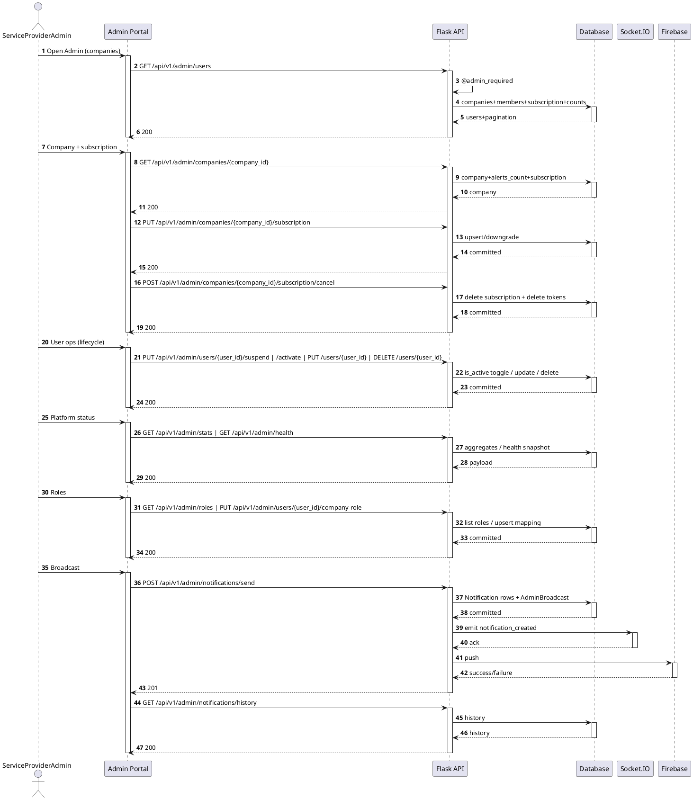
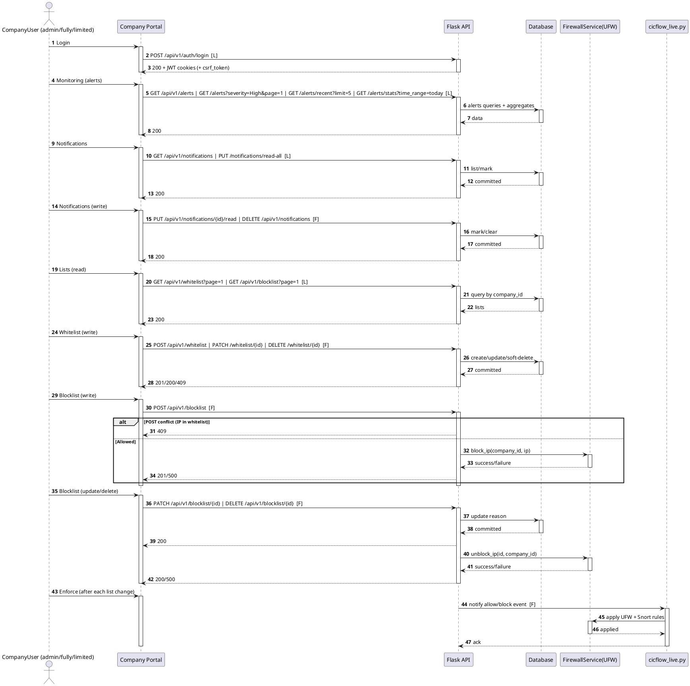
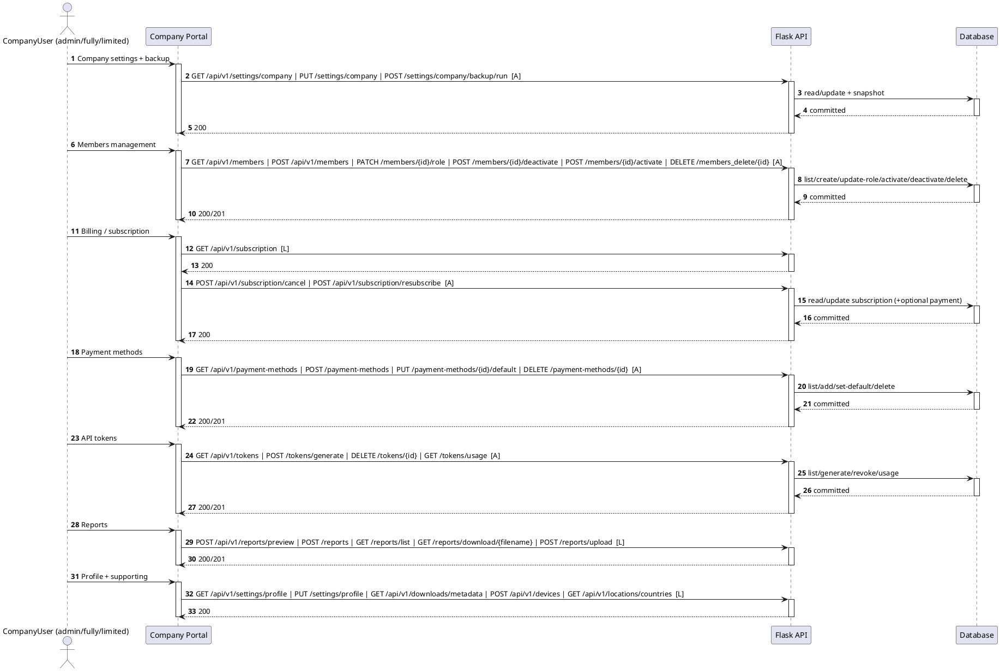
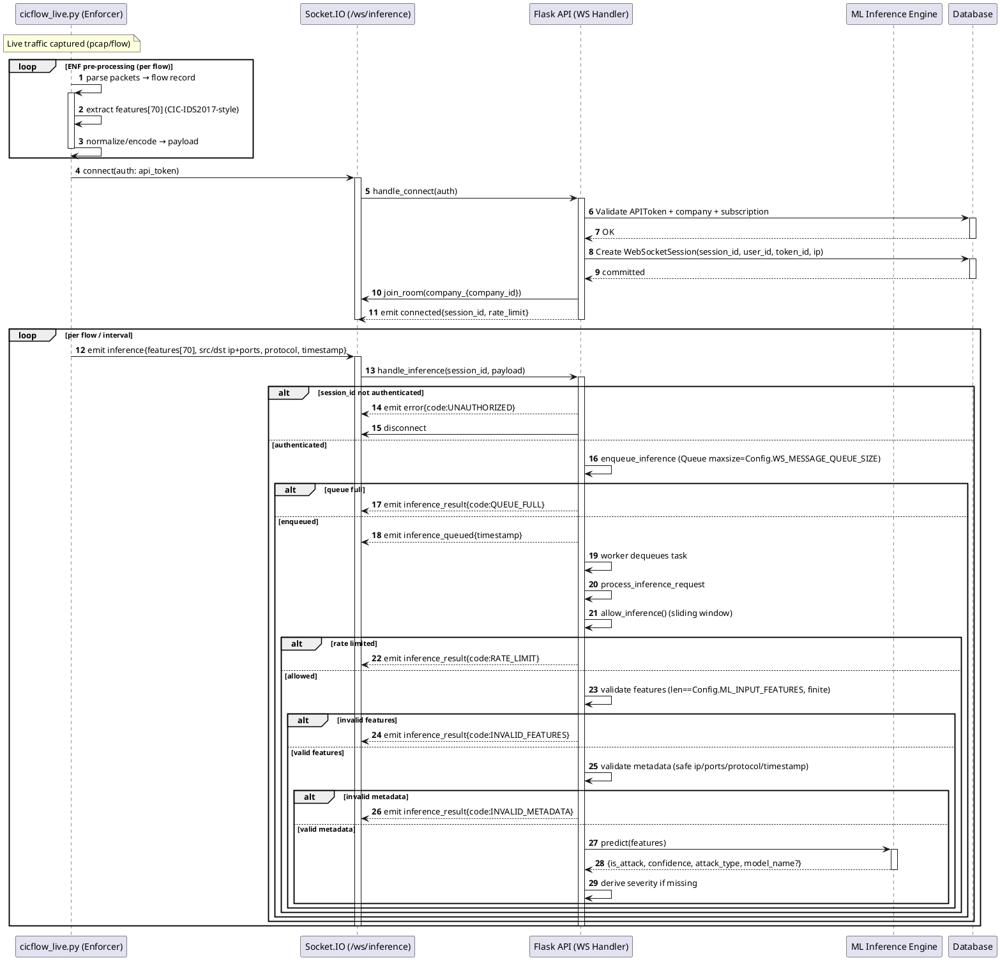
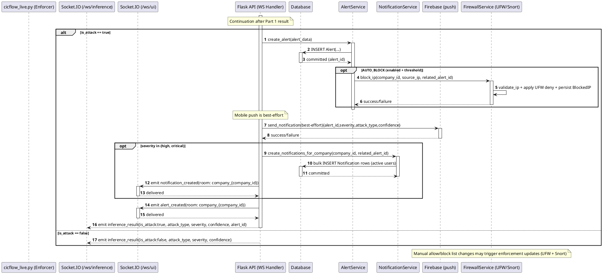
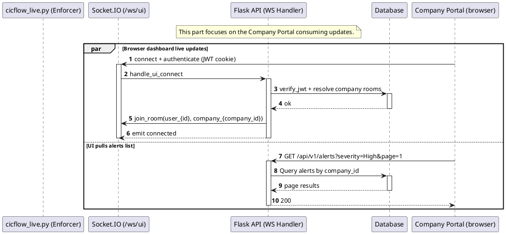

# All Sequence Diagrams — v2 (PlantUML Bundle)

This file bundles all converted **PlantUML sequence diagrams with activation bars**.

Sources included:
- `docs/diagrams/behavioral_flows_compact_sequences.md`
- `docs/diagrams/diagramfs/diagramfs/behavioral_flows_users_sequence_split.md`
- `docs/diagrams/core_detection_response_workflows.md`
- `docs/diagrams/core_detection_response_workflows_a4_split.md`

---

## 1) Behavioral Flows — Compact Sequences (PlantUML)

### 1.1 Service Provider Admin

---

## 2) Company Users — Sequences Split for Word (PlantUML)

### 2.1 Page 1 — Auth, Monitoring, Notifications, Lists, Enforcement

### 2.2 Page 2 — Admin Ops, Billing, Tokens, Reports, Profile

---

## 4) Core Detection & Response Workflows — A4 Split (PlantUML)

### 4.1 Part 1/2

### 4.2 Part 2/3

### 4.3 Part 3/3

