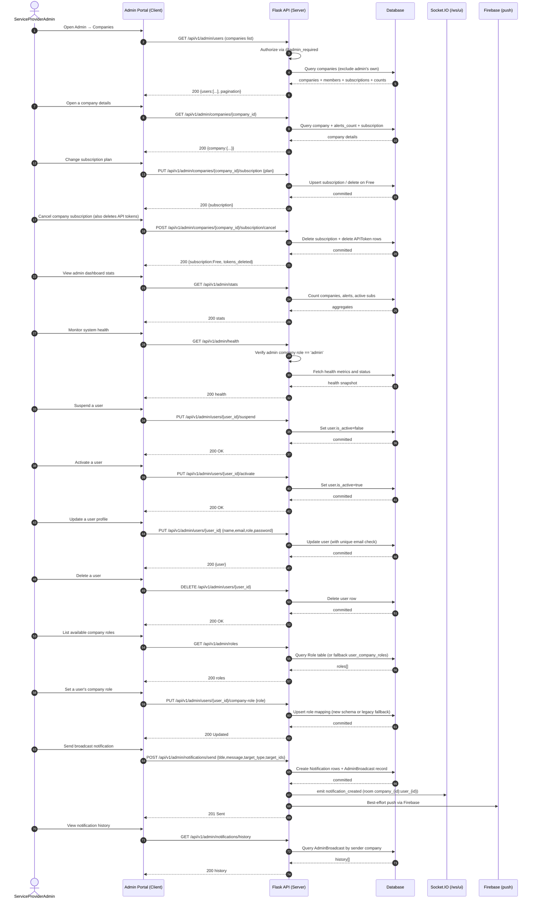
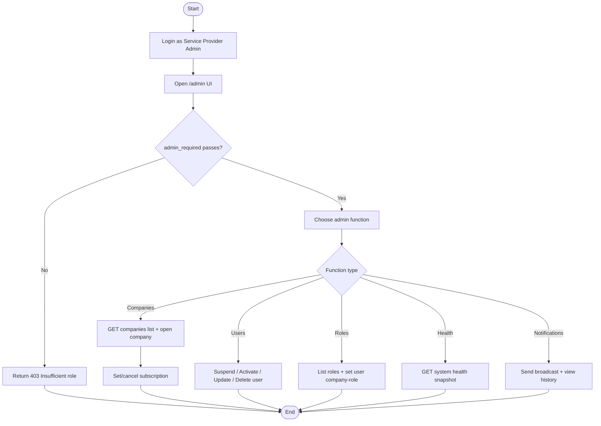
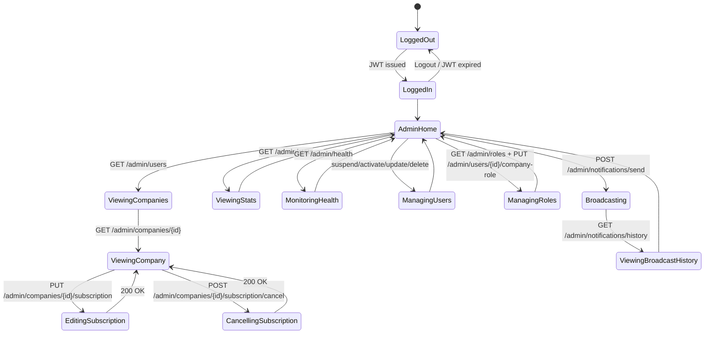
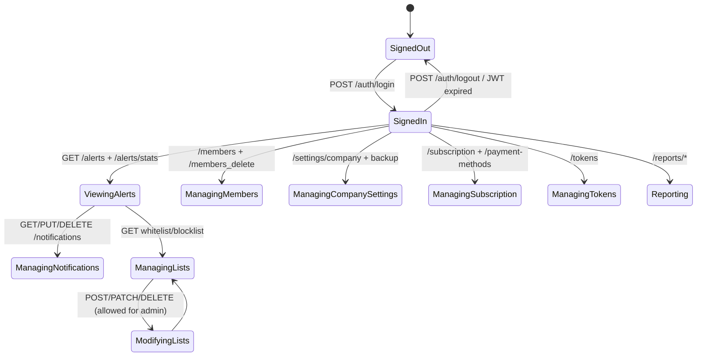
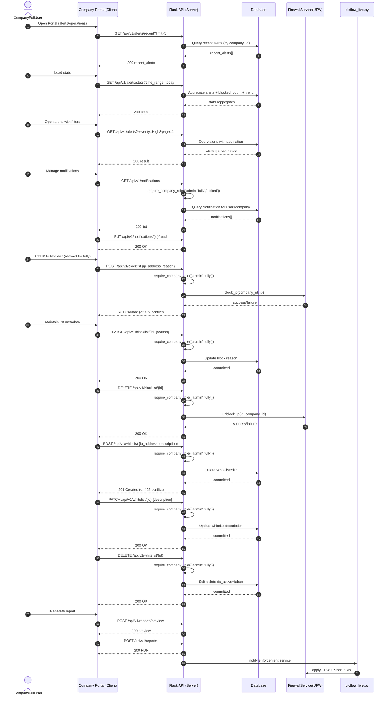
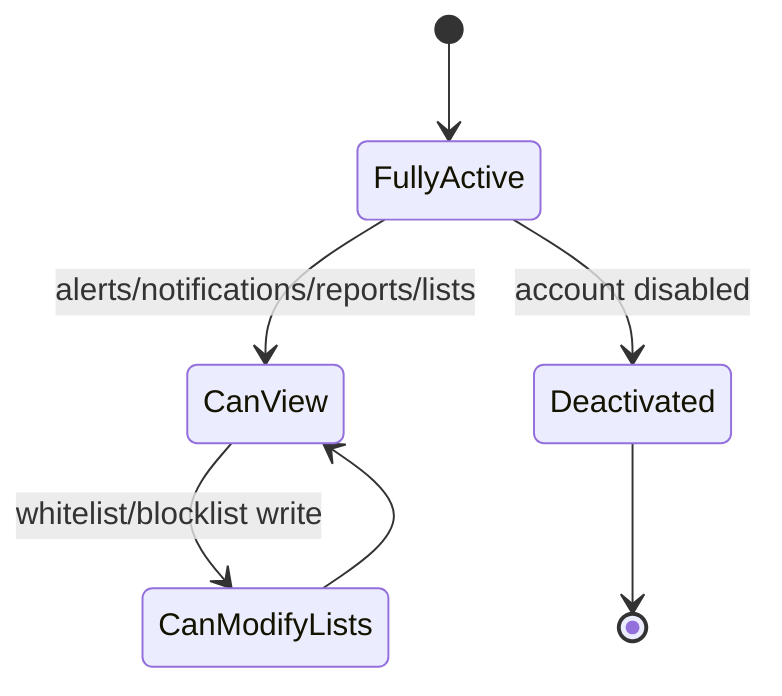
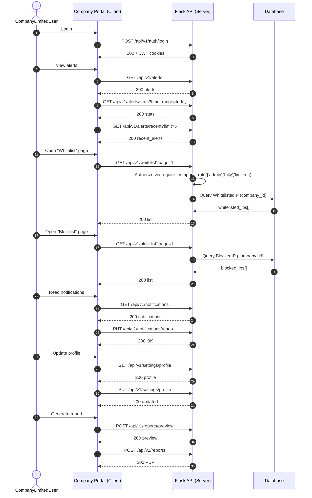
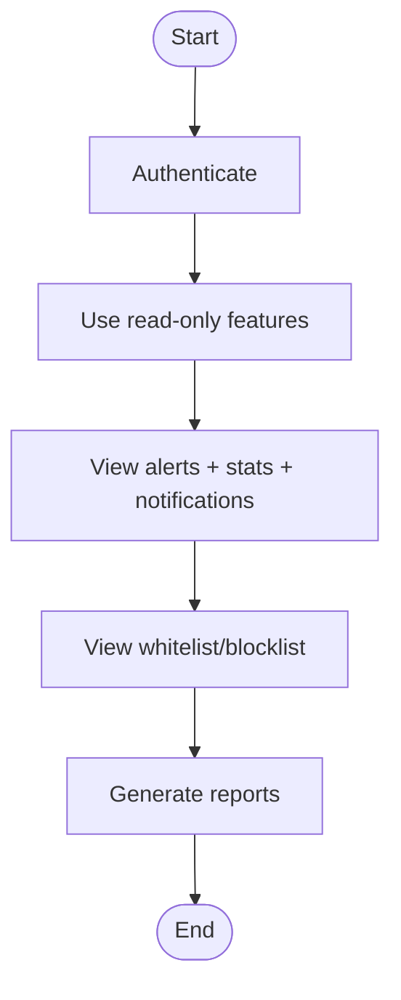
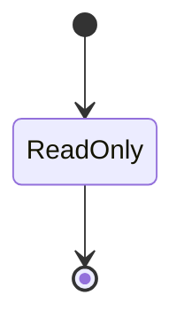

# Behavioral Flows (Mermaid)

This file contains **12 diagrams** total:
- 4 Sequence diagrams (one per role)
- 4 Activity diagrams (one per role)
- 4 State diagrams (one per role)

Roles covered (company-scoped roles you want):
1. **Service Provider Admin**: global admin endpoints protected by `@admin_required` (`server/app/blueprints/admin.py`).
2. **Company Admin**: company-scoped role `admin`.
3. **Company Fully**: company-scoped role `fully`.
4. **Company Limited**: company-scoped role `limited`.

Role name consistency note (code): some endpoints still use `full` or `fully_privileged` in decorators/tables. In this document we standardize to **`admin` / `fully` / `limited`**.

Notes about enforcement:
- **Current code path (implemented):** block/unblock uses `FirewallService` to run **UFW** commands (`server/app/services/firewall_service.py`).
- **Enforcement integration (in your current development):** when adding/removing entries in whitelist/blocklist, the API also sends a request to `elf/cicflow_live.py` so it applies **UFW** and **Snort** rules (allow/block) consistently.

---

## 1) Admin (Service Provider)

### 1.1 Sequence (Service Provider Admin: full admin operations)



### 1.2 Activity (Service Provider Admin)



### 1.3 State (Service Provider Admin Session)



---

## 2) User → Company Admin

### 2.1 Sequence (Company Admin: full company operations)

```mermaid
sequenceDiagram
	autonumber
	actor CA as CompanyAdmin
	participant UI as Company Portal (Client)
	participant API as Flask API (Server)
	participant DB as Database
	participant FW as FirewallService(UFW)
	participant ENF as cicflow_live.py

	CA->>UI: Login (browser session)
	UI->>API: POST /api/v1/auth/login {email,password,device_id?}
	API-->>UI: 200 {csrf_token,user} + HttpOnly JWT cookies

	CA->>UI: Open alerts & stats (company scope)
	UI->>API: GET /api/v1/alerts?severity=High&page=1
	API->>API: @jwt_required
	API->>DB: Query alerts by company_id with pagination
	DB-->>API: alerts[] + pagination
	API-->>UI: 200 {alerts,pagination}
	UI->>API: GET /api/v1/alerts/stats?time_range=today
	API->>DB: Aggregate alerts + blocked_count + trend
	DB-->>API: stats
	API-->>UI: 200 stats

	CA->>UI: Manage allow/block lists
	UI->>API: GET /api/v1/whitelist?page=1
	API->>API: require_company_role({'admin','fully','limited'})
	API->>DB: Query WhitelistedIP by company_id
	DB-->>API: whitelisted_ips[]
	API-->>UI: 200 list
	UI->>API: POST /api/v1/whitelist {ip_address, description}
	API->>API: require_company_role({'admin','fully'})
	API->>DB: Create WhitelistedIP (reject if already blocked)
	DB-->>API: committed
	API-->>UI: 201 Created (or 409 conflict)
	UI->>API: PATCH /api/v1/whitelist/{id} {description}
	API->>API: require_company_role({'admin','fully'})
	API->>DB: Update whitelist entry
	DB-->>API: committed
	API-->>UI: 200 OK
	UI->>API: DELETE /api/v1/whitelist/{id}
	API->>API: require_company_role({'admin','fully'})
	API->>DB: Soft-delete (is_active=false)
	DB-->>API: committed
	API-->>UI: 200 OK

	UI->>API: POST /api/v1/blocklist {ip_address,reason}
	API->>API: require_company_role({'admin','fully'})
	talt Not allowed (IP is whitelisted)
		API-->>UI: 409 cannot block whitelisted IP
	else Allowed
		API->>FW: block_ip(company_id, ip)
		FW-->>API: success/failure
		API-->>UI: 201 Created (or 500)
	end
	UI->>API: PATCH /api/v1/blocklist/{id} {reason}
	API->>API: require_company_role({'admin','fully'})
	API->>DB: Update blocklist entry
	DB-->>API: committed
	API-->>UI: 200 OK
	UI->>API: DELETE /api/v1/blocklist/{id}
	API->>API: require_company_role({'admin','fully'})
	API->>FW: unblock_ip(id, company_id)
	FW-->>API: success/failure
	API-->>UI: 200 OK

	API->>ENF: notify allow/block event
	ENF->>FW: apply UFW + Snort rules

	CA->>UI: Manage notifications
	UI->>API: GET /api/v1/notifications
	API->>API: require_company_role({'admin','fully','limited'})
	API->>DB: Query Notification by company_id + user_id
	DB-->>API: notifications[]
	API-->>UI: 200 list
	UI->>API: PUT /api/v1/notifications/read-all
	API->>DB: Update is_read=true
	DB-->>API: committed
	API-->>UI: 200 OK
	UI->>API: DELETE /api/v1/notifications
	API->>API: require_company_role({'admin','fully'})
	API->>DB: Delete notifications
	DB-->>API: committed
	API-->>UI: 200 OK

	CA->>UI: Manage company settings & backup
	UI->>API: GET /api/v1/settings/company
	API->>API: require_admin
	API->>DB: Read/ensure CompanySettings + subscription summary
	DB-->>API: settings
	API-->>UI: 200 {settings}
	UI->>API: POST /api/v1/settings/company/backup/run
	API->>API: require_admin
	API->>DB: Snapshot alerts/blocks/whitelists/users into backup store
	DB-->>API: committed
	API-->>UI: 200 backup timestamps

	CA->>UI: Manage members (company users)
	UI->>API: GET /api/v1/members
	API->>API: require_company_role({'admin'})
	API->>DB: Query company users + roles
	DB-->>API: members[]
	API-->>UI: 200 {members}
	UI->>API: POST /api/v1/members {email,name,role,country?,password?}
	API->>DB: Create user + set company role mapping
	DB-->>API: committed
	API-->>UI: 201 {member}
	UI->>API: PATCH /api/v1/members/{id}/role {role}
	API->>DB: Update company-scoped role mapping
	DB-->>API: committed
	API-->>UI: 200 {member}
	UI->>API: POST /api/v1/members/{id}/deactivate
	API->>DB: Set is_active=false
	DB-->>API: committed
	API-->>UI: 200 {member}
	UI->>API: DELETE /api/v1/members_delete/{id}
	API->>API: require_company_role({'admin'})
	API->>DB: Delete member (cannot delete self)
	DB-->>API: committed
	API-->>UI: 200 OK

	CA->>UI: Manage subscription & payment methods
	UI->>API: GET /api/v1/subscription
	API->>API: user_required
	API->>DB: Read subscription for company_id
	DB-->>API: subscription
	API-->>UI: 200 {subscription}
	UI->>API: GET /api/v1/payment-methods
	API->>API: require_admin
	API->>DB: List active payment methods
	DB-->>API: methods[]
	API-->>UI: 200 {payment_methods}
	UI->>API: POST /api/v1/subscription/resubscribe {plan, card_*?}
	API->>API: require_company_role({'admin'})
	API->>DB: Create/update subscription + optional payment method
	DB-->>API: committed
	API-->>UI: 200 {subscription}

	CA->>UI: Manage API tokens (admin-only)
	UI->>API: GET /api/v1/tokens
	API->>API: require_admin
	API->>DB: List active APIToken by company_id
	DB-->>API: tokens[]
	API-->>UI: 200 {tokens}
	UI->>API: POST /api/v1/tokens/generate
	API->>DB: Delete existing tokens + create new token
	DB-->>API: committed
	API-->>UI: 201 {token,token_info}

	CA->>UI: Generate/download reports
	UI->>API: POST /api/v1/reports/preview {start_date,end_date,include_*}
	API->>API: user_required
	API->>DB: Count alerts/blocks/whitelist by tenant_id
	DB-->>API: preview counts
	API-->>UI: 200 preview
	UI->>API: POST /api/v1/reports {date_range,include_*}
	API->>DB: Generate PDF + persist tenant copy
	DB-->>API: committed
	API-->>UI: 200 PDF download
	UI->>API: GET /api/v1/reports/list
	API-->>UI: 200 reports[]
	UI->>API: GET /api/v1/reports/download/{filename}
	API-->>UI: 200 PDF

	CA->>UI: Misc supporting endpoints
	UI->>API: GET /api/v1/downloads/metadata
	API-->>UI: 200 platforms[]
	UI->>API: POST /api/v1/devices {device_id, device_token?}
	API-->>UI: 200 device
	UI->>API: GET /api/v1/locations/countries
	API-->>UI: 200 countries[]
```

### 2.2 Activity (Company Admin)

```mermaid
flowchart TD
	A([Start]) --> B[Authenticate (login + CSRF token)]
	B --> C[Open Company Portal]
	C --> D{Role == company admin?}
	D -- No --> E[Hide admin-only controls] --> F[Use user features (alerts, reports, lists)] --> Z([End])
	D -- Yes --> G[Admin feature hub]
	G --> H{Choose feature}
	H -- Members --> I[GET/POST/PATCH/activate/deactivate/delete members]
	H -- Company settings --> J[GET/PUT /settings/company + backup run]
	H -- Subscription --> K[GET /subscription + POST cancel/resubscribe]
	H -- Payment methods --> L[GET/POST/DELETE/PUT default]
	H -- API tokens --> M[GET/generate/revoke/usage]
	H -- Security ops --> N[Manage whitelist/blocklist (writes allowed)]
	H -- Reporting --> O[Preview/generate/list/download/upload reports]
	I --> Z
	J --> Z
	K --> Z
	L --> Z
	M --> Z
	N --> Z
	O --> Z
```

### 2.3 State (Company Admin Session Capabilities)



---

## 3) User → Company Fully

### 3.1 Sequence (Company Fully: monitor + respond)



### 3.2 Activity (Company Fully)

```mermaid
flowchart TD
	A([Start]) --> B[Authenticate]
	B --> C[View alerts + stats]
	C --> D[Review notifications]
	D --> E[Open whitelist/blocklist]
	E --> F{Write allowed? (fully/admin)}
	F -- No --> G[Read-only] --> Z([End])
	F -- Yes --> H[Add/update/remove list entries]
	H --> I[FirewallService(UFW) for block/unblock]
	I --> J[DB commit + UI refresh]
	J --> K[Optional: Generate report]
	K --> Z
```

### 3.3 State (User Capability State)



---

## 4) User → Company Limited

### 4.1 Sequence (Company Limited: view-only operations)



### 4.2 Activity (Company Limited)



### 4.3 State (Limited User Permission State)



