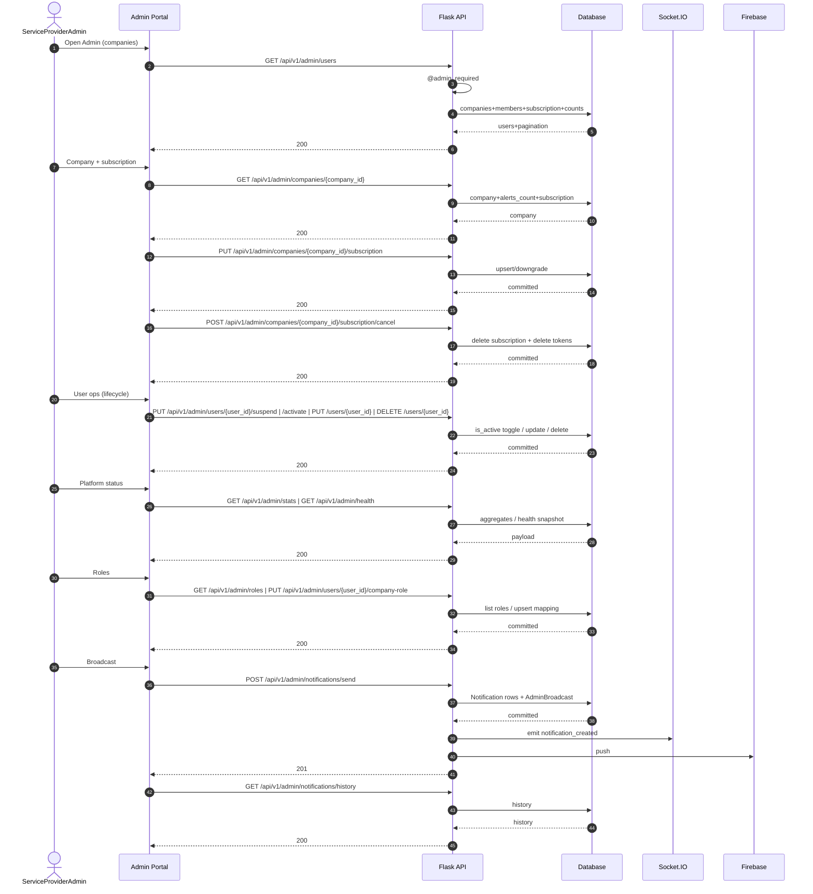
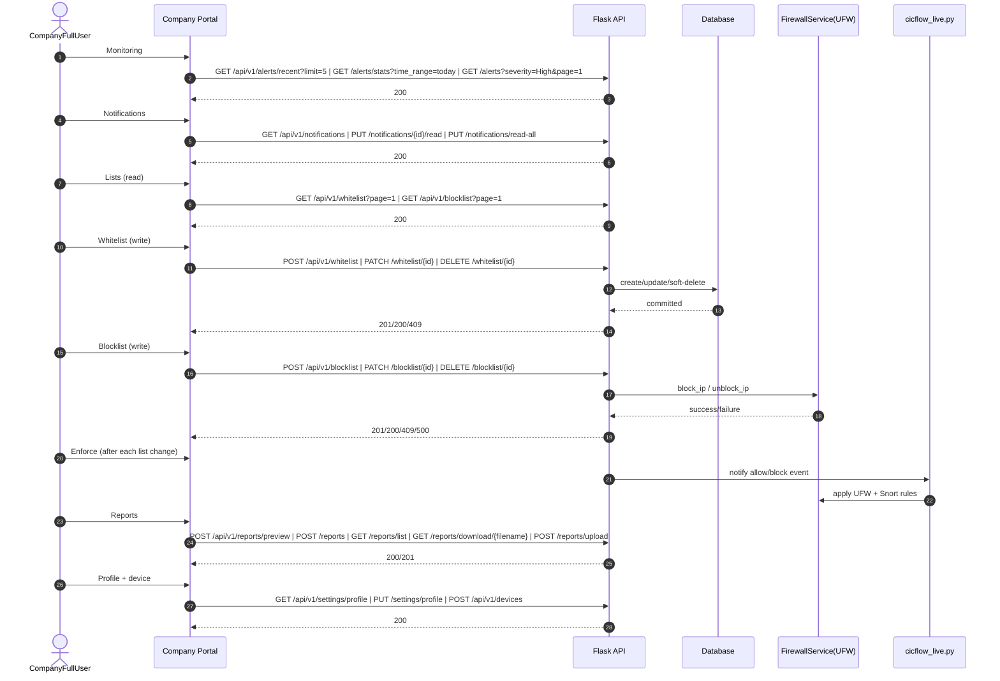
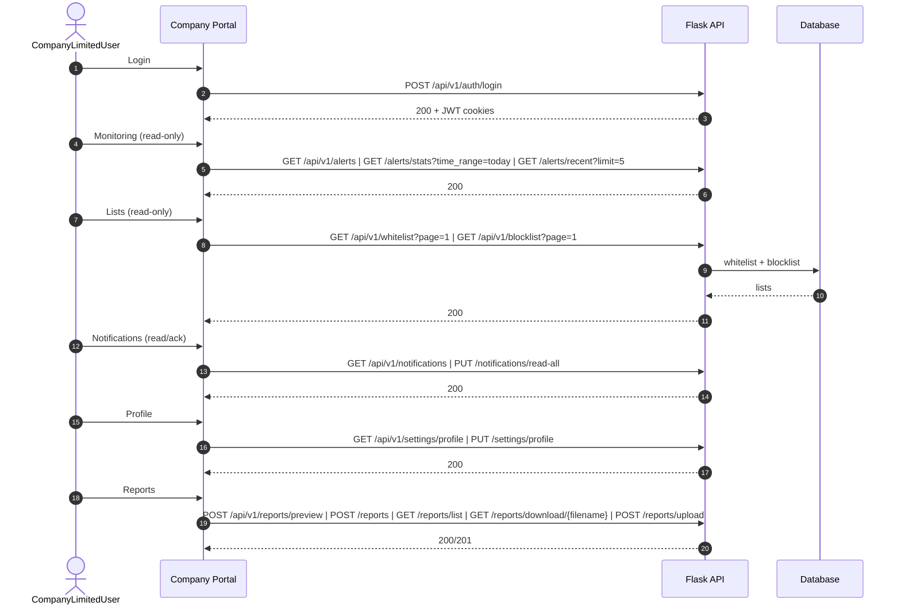

# Behavioral Flows — Compact Sequence Diagrams (A4)

This file contains **4 compact Mermaid sequence diagrams** (one per role scope).
Goal: keep **all behaviors/endpoints** while reducing vertical length by grouping repeated calls.

Roles:
- Service Provider Admin
- Company Admin (`admin`)
- Company Fully (`fully`)
- Company Limited (`limited`, read-only)

---

## 1) Service Provider Admin — Compact Sequence



---

## 2) Company Admin (`admin`) — Compact Sequence

```mermaid
sequenceDiagram
	autonumber
	actor CA as CompanyAdmin
	participant UI as Company Portal
	participant API as Flask API
	participant DB as Database
	participant FW as FirewallService(UFW)
	participant ENF as cicflow_live.py

	CA->>UI: Login
	UI->>API: POST /api/v1/auth/login
	API-->>UI: 200 + JWT cookies + csrf_token

	CA->>UI: Monitoring
	UI->>API: GET /api/v1/alerts?severity=High&page=1 | GET /alerts/stats?time_range=today | GET /alerts/recent?limit=5
	API->>DB: alerts (paged) + aggregates + recent
	DB-->>API: data
	API-->>UI: 200

	CA->>UI: Lists (read)
	UI->>API: GET /api/v1/whitelist?page=1 | GET /api/v1/blocklist?page=1
	API->>DB: whitelist + blocklist
	DB-->>API: lists
	API-->>UI: 200

	CA->>UI: Whitelist (write)
	UI->>API: POST /api/v1/whitelist | PATCH /whitelist/{id} | DELETE /whitelist/{id}
	API->>DB: create/update/soft-delete
	DB-->>API: committed
	API-->>UI: 201/200/409

	CA->>UI: Blocklist (write)
	UI->>API: POST /api/v1/blocklist | PATCH /blocklist/{id} | DELETE /blocklist/{id}
	talt POST conflict (IP in whitelist)
		API-->>UI: 409
	else Writes execute
		API->>FW: block_ip / unblock_ip
		FW-->>API: success/failure
		API-->>UI: 201/200/500
	end

	CA->>UI: Enforce (after each list change)
	API->>ENF: notify allow/block event
	ENF->>FW: apply UFW + Snort rules

	CA->>UI: Notifications
	UI->>API: GET /api/v1/notifications | PUT /notifications/{id}/read | PUT /notifications/read-all | DELETE /notifications
	API->>DB: list + mark read + clear
	DB-->>API: committed
	API-->>UI: 200

	CA->>UI: Company settings + backup
	UI->>API: GET /api/v1/settings/company | PUT /settings/company | POST /settings/company/backup/run
	API->>DB: read/update + snapshot backup
	DB-->>API: committed
	API-->>UI: 200

	CA->>UI: Members
	UI->>API: GET /api/v1/members | POST /members | PATCH /members/{id}/role | POST /members/{id}/deactivate | POST /members/{id}/activate | DELETE /members_delete/{id}
	API->>DB: list/create/role change/activate/deactivate/delete
	DB-->>API: committed
	API-->>UI: 200/201

	CA->>UI: Billing
	UI->>API: GET /api/v1/subscription | POST /subscription/cancel | POST /subscription/resubscribe
	API->>DB: read/update subscription (+optional payment)
	DB-->>API: committed
	API-->>UI: 200
	UI->>API: GET /api/v1/payment-methods | POST /payment-methods | PUT /payment-methods/{id}/default | DELETE /payment-methods/{id}
	API->>DB: list/add/set-default/delete
	DB-->>API: committed
	API-->>UI: 200/201

	CA->>UI: API tokens
	UI->>API: GET /api/v1/tokens | POST /tokens/generate | DELETE /tokens/{id} | GET /tokens/usage
	API->>DB: list/generate/revoke/usage
	DB-->>API: committed
	API-->>UI: 200/201

	CA->>UI: Reports
	UI->>API: POST /api/v1/reports/preview | POST /reports | GET /reports/list | GET /reports/download/{filename} | POST /reports/upload
	API->>DB: preview counts + generate/persist + list/download/upload
	DB-->>API: committed
	API-->>UI: 200/201

	CA->>UI: Supporting
	UI->>API: GET /api/v1/downloads/metadata | POST /api/v1/devices | GET /api/v1/locations/countries
	API-->>UI: 200
```

---

## 3) Company Fully (`fully`) — Compact Sequence



---

## 4) Company Limited (`limited`) — Compact Sequence (Read-only)


