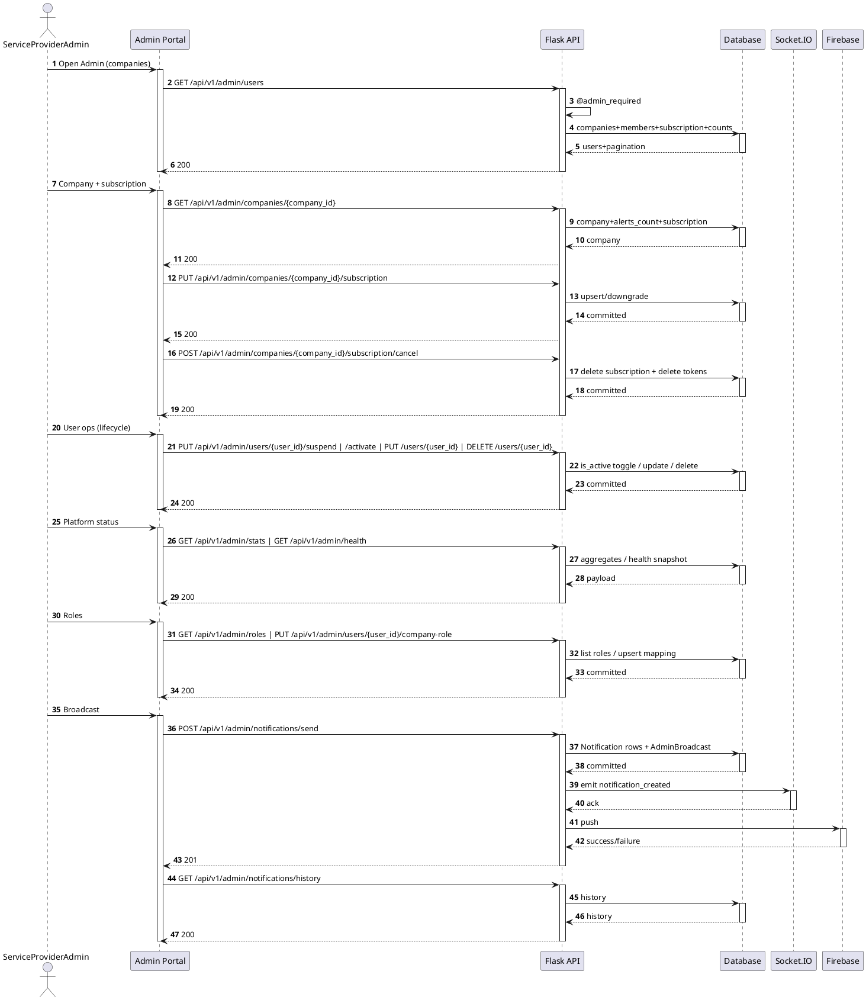

# Behavioral Flows — Compact Sequence Diagrams (A4) — v2 (PlantUML)

This is a PlantUML conversion of the Mermaid sequence diagrams from:
- `docs/diagrams/behavioral_flows_compact_sequences.md`

It uses **activation bars** (`activate`/`deactivate`) for readability.

---

## 1) Service Provider Admin — Compact Sequence (PlantUML)

