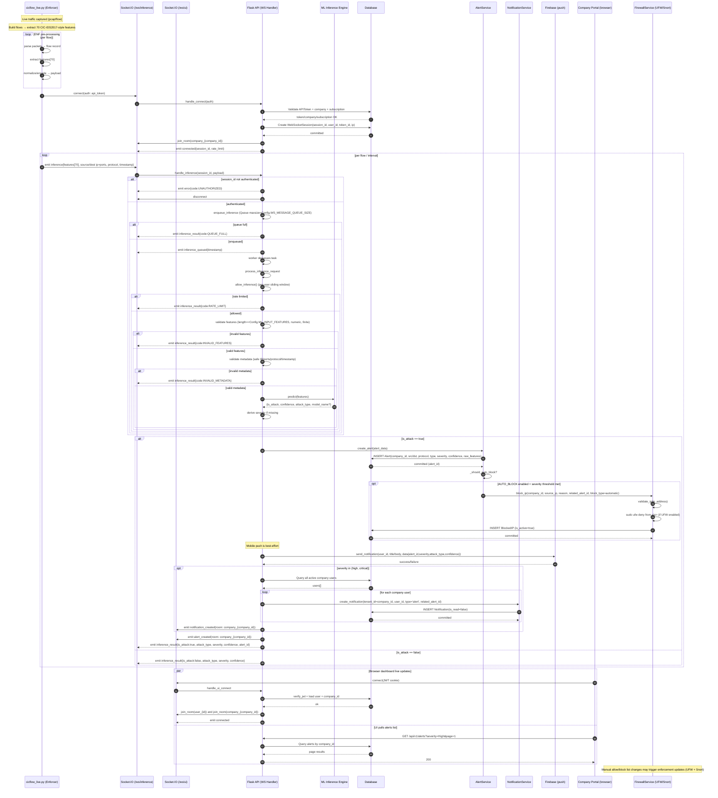

# Core Detection & Response Workflows

This document describes the **end-to-end real-time detection and response** pipeline.

Key implementation anchors:
- WebSocket inference ingestion + UI updates: `server/app/websocket/server.py`
- Alert persistence + optional auto-block: `server/app/services/alert_service.py`
- In-app notifications: `server/app/services/notification_service.py`
- Mobile push (Firebase): `server/app/services/firebase_service.py`
- UFW blocking/unblocking: `server/app/services/firewall_service.py`

> Naming note: the participants below intentionally match the lane names from your diagram image.

---

## Sequence — Real-time Inference → Alert → Notifications → Response

