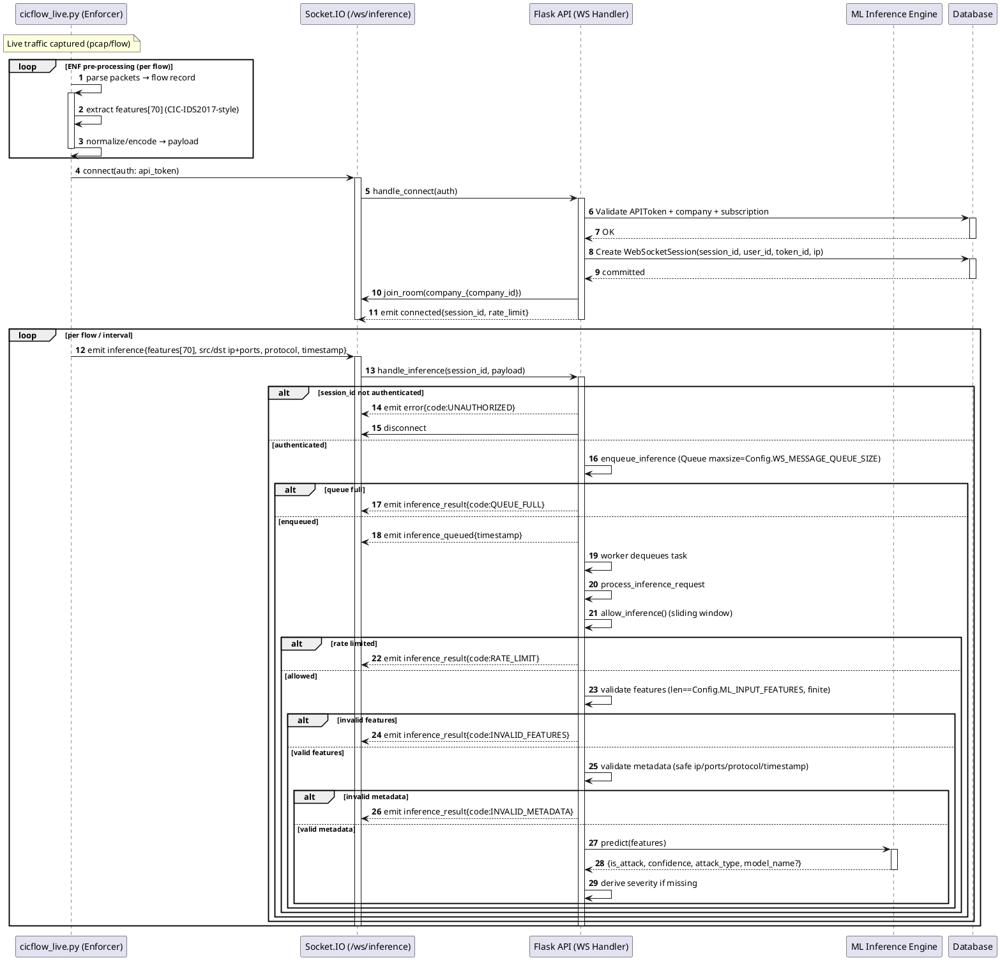
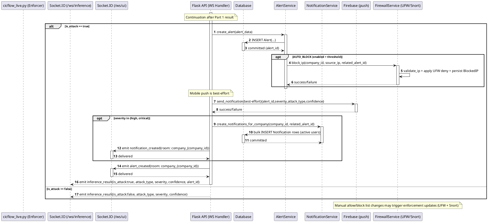

# Core Detection & Response Workflows — A4 Split — v2 (PlantUML)

This is a PlantUML conversion of:
- `docs/diagrams/core_detection_response_workflows_a4_split.md`

It keeps the same participant lane names and adds **activation bars**.

---

## Part 1/2 — Enforcer Pre-processing + WS Ingest + Queue + Validation + ML (PlantUML)



---

## Part 2/3 — Attack Handling: Alert + Auto-block + Notifications (PlantUML)



---

## Part 3/3 — UI Dashboard Live Updates + Alerts Pull (PlantUML)

```plantuml
@startuml
autonumber

participant ENF as "cicflow_live.py (Enforcer)"
participant WSUI as "Socket.IO (/ws/ui)"
participant WSH as "Flask API (WS Handler)"
participant DB as "Database"
participant UI as "Company Portal (browser)"

note over WSH
This part focuses on the Company Portal consuming updates.
end note

par Browser dashboard live updates
  UI -> WSUI: connect + authenticate (JWT cookie)
  activate WSUI
  WSUI -> WSH: handle_ui_connect
  activate WSH
  WSH -> DB: verify_jwt + resolve company rooms
  activate DB
  DB --> WSH: ok
  deactivate DB
  WSH -> WSUI: join_room(user_{id}, company_{company_id})
  WSH --> WSUI: emit connected
  deactivate WSH
  deactivate WSUI
else UI pulls alerts list
  UI -> WSH: GET /api/v1/alerts?severity=High&page=1
  activate WSH
  WSH -> DB: Query alerts by company_id
  activate DB
  DB --> WSH: page results
  deactivate DB
  WSH --> UI: 200
  deactivate WSH
end

@enduml
