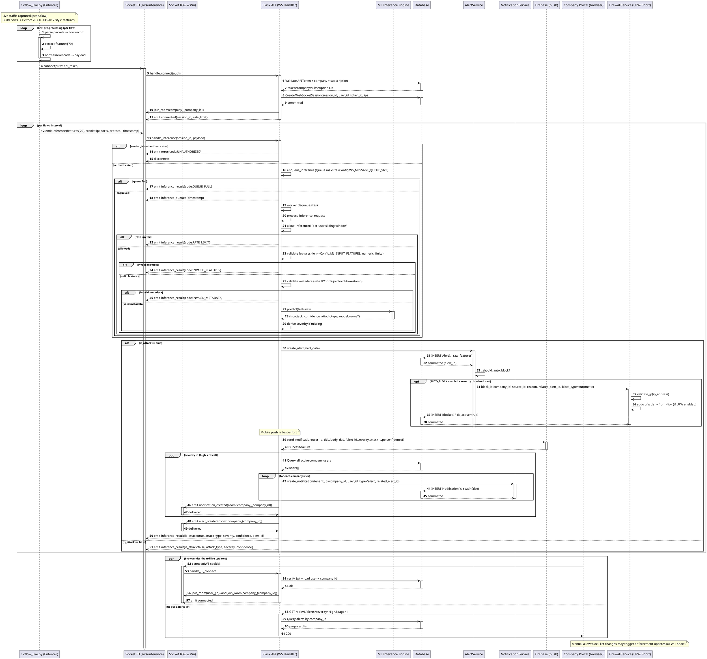

# Core Detection & Response Workflows — v2 (PlantUML)

This is a PlantUML conversion of the Mermaid sequence diagram from:
- `docs/diagrams/core_detection_response_workflows.md`

It uses **activation bars** (`activate`/`deactivate`).

---

## Sequence — Real-time Inference → Alert → Notifications → Response (PlantUML)

