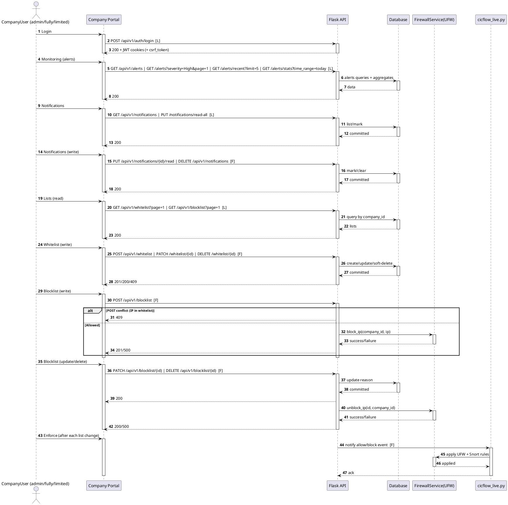
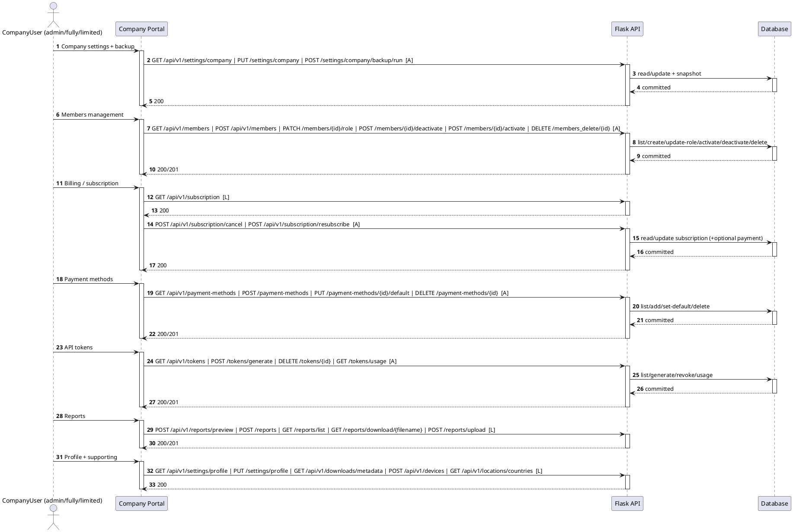

# Company Users — Sequence Diagrams (Split for Word) — v2 (PlantUML)

This is a PlantUML conversion of:
- `docs/diagrams/diagramfs/diagramfs/behavioral_flows_users_sequence_split.md`

It adds **activation bars** and preserves permission markers `[L] [F] [A]`.

---

## Page 1 — Auth, Monitoring, Notifications, Lists, Enforcement (PlantUML)

---

## Page 2 — Admin Ops, Billing, Tokens, Reports, Profile (PlantUML)

